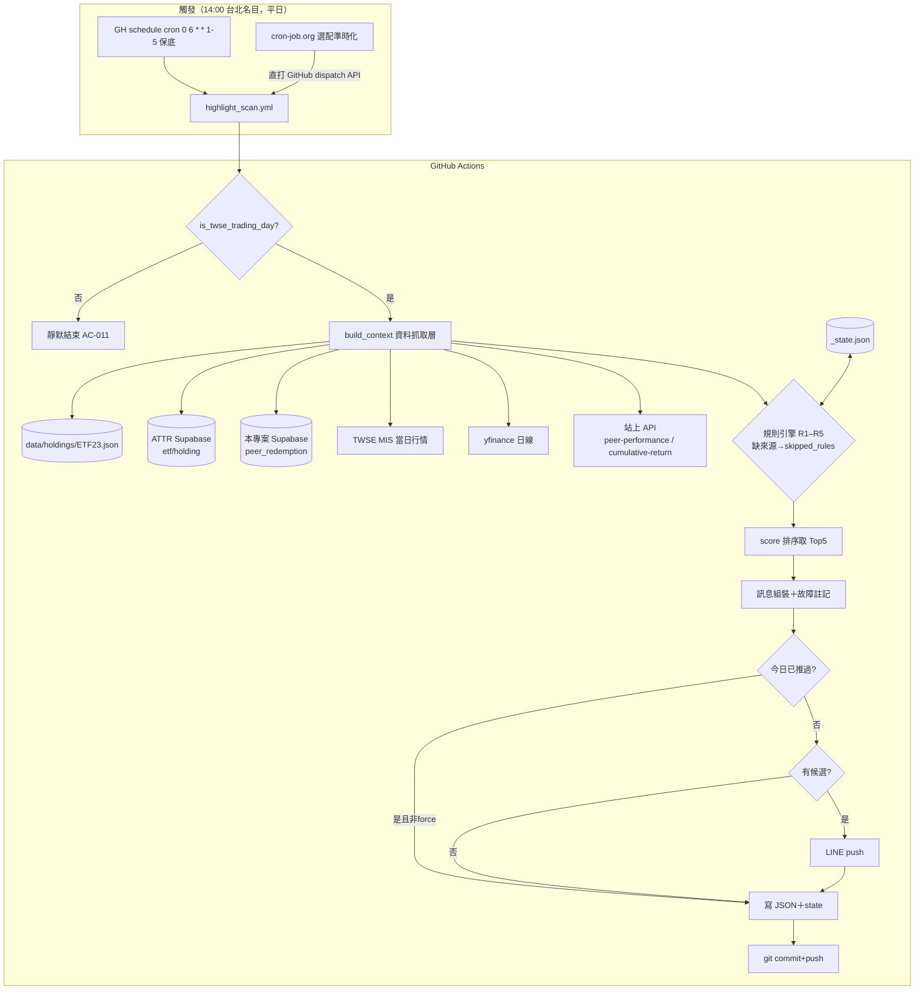

# design.md — 每日行銷亮點引擎（daily-highlight-engine）技術設計

> 技術真相（How）。需求真相見 [spec.md](spec.md)。所有引用路徑均經實際讀碼驗證。

## 0. Spec-vs-Codebase 矛盾點（已回寫修正 spec）

| # | 原假設 | 實際 codebase | 處置 |
|---|---|---|---|
| 1 | 持股存檔名 `00991A（ETF23）.json` | 實檔為 **`data/holdings/ETF23.json`**（`scripts/update_holdings.py` 以 fundId 命名） | spec 已修正 |
| 2 | peer-performance route 有「RECENT_DIVIDENDS override」 | **查無此機制**（grep 全 repo 無；git log 顯示除息問題由 commit `9f1cd75` 券商先進位算法＋除息日基準修正解決）。route 實際為 yahoo adjClose + TWSE MIS anomaly 偵測（偵測不修正） | R4 呼叫站上 API 即繼承此口徑，無額外除息邏輯要重做 |
| 3 | R5「同業第一」與 R1/R2 同用 19 檔 | `peer_redemption` tw_active 僅 **6 檔**（`daily_summary.py` `PEER_ETFS`） | spec 已加註：文案寫「觀測同業中」不得稱全市場第一 |
| 4 | 全市場「19 檔」 | active-etf-tracker `etf_universe.py::TW_EQUITY` 已 **20 檔**（含 00404A/00406A/00407A；`lib/peerGroups.ts` 尚未同步） | R1/R2 universe 動態查 Supabase `etf` 表，不寫死清單 |
| 5 | R3 權重門檻未明講看哪天 | 純新邏輯無對照 | 定義為「**事件當日**權重 ≥ 0.5%」（後續清倉不影響驗證） |
| 6 | 「排在 17:30 update_holdings 之後（18:30）即可拿到當日持股」 | update_holdings 用 GH native cron，**實際落地 19:50–21:50 台北**（實測 run 紀錄，GH cron 延遲 2–4 小時）——18:30 掃描時 git 存檔常常還停在前一交易日 | `fetch_own_holdings_history` 必須做 **fhtrust 即時補抓**：存檔缺今日 → GET `fhtrust /api/assets?fundID=ETF23&qDate={today}` 即時取得並轉成 `{c,q,m,p}` 併入（fhtrust API 已實測正常回當日資料） |

## 1. System Analysis — Impact Scope

**新增檔案（不改任何既有前端／既有 workflow 行為）：**

```
scripts/highlight_scan.py                # 主程式
scripts/test_highlight_scan.py           # pytest 單元/整合測試
config/highlight_thresholds.json         # FR-08 閾值設定檔
data/highlights/{YYYY-MM-DD}.json        # 每日產出（workflow commit）
data/highlights/_state.json              # 去重/里程碑狀態（workflow commit）
.github/workflows/highlight_scan.yml     # 獨立 workflow（workflow_dispatch only）
```

**修改的既有檔案：無**（v1 排程改走 GH `schedule:`＋cron-job.org 直打 dispatch API，trigger route 不動、零 Vercel 部署，見 §7）。

**重用（import 或呼叫，皆不修改）：**

| 來源 | 具體符號/端點 | 用途 |
|---|---|---|
| `scripts/daily_summary.py` | `is_twse_trading_day(d)`、`get_with_retry` | 交易日判斷（AC-011） |
| `data/holdings/ETF23.json` | `{fundId,names,days}` 結構（update_holdings 17:30 產出） | R1/R2/R3 的 00991A 持股序列 |
| Supabase（active-etf-tracker，唯讀 anon） | 表 `etf(ticker,name,market,type)`、`holding` 僅 select **`ticker,date,stockid,prate`**（`lib/attribution.ts` 驗證過的欄位；`qshare` 未經驗證不得引用——review S1） | R1/R2 全市場持股比較 |
| `https://fhactiveetf.vercel.app/api/peer-performance?group=active` | 回傳含 `pct1d/pctMTD/pctYTD/...` | R4 排名事件 |
| `https://fhactiveetf.vercel.app/api/cumulative-return?group=active&tickers=00991A,0050&startDate=2020-01-01&endDate={today}` | 含息累積報酬序列（**startDate/endDate 皆必填**，缺一回 400——review M1） | R4 累積新高＋連勝日報酬 |
| Supabase（本專案）`peer_redemption` | `date,ticker,net_sub,aum,group` | R5 資金流 |
| TWSE MIS `getStockInfo.jsp` | 批次即時報價（比照 `peer-performance/route.ts` `fetchTwseLatestTraded`） | R1/R2 個股當日漲幅 |
| `etf-daily-line/scripts/daily_summary.py` `send_line()` | `POST api.line.me/v2/bot/message/push`，`{to, messages}` | LINE push（改 text 訊息） |
| `.github/workflows/update_holdings.yml` | git-as-database commit-back 樣式 | JSON/state 存檔 |

## 2. Architecture Diagram



## 3. Module Design — `scripts/highlight_scan.py`

單檔 flat-module（比照 `daily_summary.py` 風格），分段：

```
── Config ──
load_config() -> dict          # 讀 config/highlight_thresholds.json；缺檔 sys.exit（FR-08 不接受硬編碼 fallback）

── State ──
@dataclass DedupState:
    pushed_dates: list[str]
    r3_events: dict[str, dict]     # "{stockid}|{event_date}" -> {direction, tier_pushed}
    r4_rank: dict[str, dict]       # {"mtd": {period, last_rank}, "ytd": {...}}
    r4_new_high: dict              # {"last_high_date"}  ← 記「上次推播日」非「上次創高日」
    r5_aum_milestones: list[int]
load_state() / save_state() / prune_state()   # r3_events 過 20 交易日窗清除；pushed_dates 留 60 筆

── Data-access layer（每函式獨立 try/except，失敗回 None）──
fetch_own_holdings_history(fund_id='ETF23')          # 本地 JSON＋live top-up：
                                                     #   存檔缺今日 → GET fhtrust assets?fundID=ETF23&qDate=today
                                                     #   轉 {c,q,m,p} 併入（不回寫檔案，只在記憶體）
fetch_tw_active_universe()                           # PostgREST etf?market=eq.tw&type=eq.equity（動態清單）
fetch_cross_fund_holdings(tickers, as_of, lookback_days=15)   # holding 表 as-of 快照（各檔基金申報日曆不同步，須窗口讀）
fetch_stock_daily_change(stockids)                   # TWSE MIS 批次；缺漏逐檔 yfinance fallback（.TW→.TWO）
fetch_stock_60d_high(stockid)                        # yfinance 4mo close rolling max
fetch_stock_price_on/_latest(stockid)                # R3 至今報酬（原始 close，未還原息，循 stockTrajectory 慣例）
fetch_site_peer_performance(group='active')          # 站上 API（30s timeout＋1 重試）
fetch_site_cumulative_return(tickers='00991A,0050', start='2020-01-01', end=today)
    # startDate/endDate 皆必填（review M1）；一次帶兩檔
    # R4 連勝日報酬由 pct 序列推導：r_t=(1+p_t)/(1+p_{t-1})-1（review S3：口徑與站上一致，免 yfinance）
fetch_peer_redemption_history(start, end, group='tw_active')  # PostgREST 本專案

── Context ──
@dataclass ScanContext            # 欄位=各 fetch 回傳；None=來源故障
build_context(today, cfg) -> (ctx, sources_status)

── Rule engine（純函式：讀 state 判去重、輸出 Candidate；寫 state 延後）──
@dataclass Candidate:
    id; rule; score; fact; angle; draft
    data: dict                    # 數字溯源
    state_patch: dict | None      # 入選後 caller 才套用
rule_r1(ctx, cfg) / rule_r2(ctx, cfg) / rule_r3(ctx, cfg, state)
rule_r4(ctx, cfg, state) / rule_r5(ctx, cfg, state)
RULES = [(name, fn, needs=[來源鍵])]   # 缺任一來源→跳過並記 skipped_rules
run_rules(ctx, sources_status, cfg, state) -> (candidates, skipped_rules)

── Ranking / Message / Sender / Archiver ──
select_top(candidates, limit=5)
build_message(selected, date, skipped_rules, max_chars=4500)
    # 超長從最低分「整條移除」（不做字元截斷）；footer 固定；skipped 註記「本日未掃描：Rx」
send_line_text(text) -> status   # POST /v2/bot/message/push
send_line_alert(text)            # 全源故障維運告警（簡短、非行銷格式）
write_daily_json(...)            # data/highlights/{date}.json
apply_state_patches(state, selected)   # 只對入選 Top5 落地去重狀態

── Main ──
main():
    today = env SCAN_DATE override or now(Asia/Taipei).date()
    if is_twse_trading_day(today) is False: return          # AC-011（None=TWSE不可達→視為交易日續跑）
    cfg, state = load_config(), load_state()
    ctx, sources_status = build_context(today, cfg)
    if 全部來源 fail: send_line_alert(); write_json(); sys.exit(1)   # workflow 紅燈
    candidates, skipped = run_rules(...)
    selected, rest = select_top(candidates, cfg.message.max_items)
    force = env FORCE_RESEND=='1'
    if not candidates: push=None                            # FR-04 靜默
    elif today in state.pushed_dates and not force: push=None   # AC-009 冪等
    else:
        status = send_line_text(build_message(...))
        if status == 200: state.pushed_dates += [today]     # review M2：只有真的送達才標記
        else: push_failed = True                            # 不標記→下次重跑會重試
    apply_state_patches(state, selected)                    # 僅在 status==200（或無需推播）時套用
    prune_state(); save_state()
    write_daily_json(today, all, selected, sources_status, skipped, push)
    if push_failed: send_line_alert('LINE push failed'); sys.exit(1)   # workflow 紅燈可見
```

**首跑韌性（review S4）**：`load_state` 檔案不存在→回空 `DedupState`；`write_daily_json` 先 `os.makedirs(exist_ok=True)`；`r4_rank/r4_new_high` 缺 key＝首次語意（可推）。R5 雙保險天然處理首跑。

```
```

**關鍵原則**：dedup 判斷在規則函式內（讀 state），state **寫入只對入選 Top5 落地**——未入選的達標事件下次仍會浮現，避免「沒推到卻標記已推」的永久遺漏。

## 4. Config — `config/highlight_thresholds.json`

新目錄 `config/`（與 `data/`、`scripts/` 三分）。純 JSON；調完手動重跑 workflow 即生效（FR-08）。

```json
{
  "version": 1,
  "r1": { "min_daily_pct": 3.0, "top_n_holdings": 10 },
  "r2": { "overweight_multiple": 2.0, "overweight_min_weight_pct": 1.0,
          "min_daily_pct": 5.0, "new_high_lookback_days": 60,
          "exclusive_score_multiplier": 1.5 },
  "r3": { "lookback_trading_days": 20, "min_qty_change_pct": 10.0,
          "min_weight_pct": 0.5, "tiers_pct": [8, 15, 30] },
  "r4": { "streak_days": [3, 5, 10], "rank_top_n": 3,
          "new_high_cooldown_trading_days": 5, "benchmark_ticker": "0050" },
  "r5": { "streak_days": [5, 10, 20], "aum_milestone_billion_twd": 50,
          "single_day_min_billion_twd": 1.0, "peer_group": "tw_active" },
  "message": { "max_items": 5, "max_chars": 4500,
               "footer": "⚠️ 內部參考素材，對外使用前需經法遵檢視" },
  "scoring": { "r3_multiplier": 2.0, "r4_streak_multiplier": 3.0,
               "r4_rank_multiplier": 10.0, "r4_new_high_score": 15.0,
               "r5_streak_multiplier": 2.0, "r5_milestone_score": 12.0,
               "r5_single_day_first_score": 10.0 }
}
```

## 5. State & Archive JSON Schemas

### 5.1 `data/highlights/{YYYY-MM-DD}.json`

```json
{
  "date": "2026-07-03",
  "scanned_at": "2026-07-03T18:31:04+08:00",
  "config_snapshot": { "r1": {}, "r2": {}, "r3": {}, "r4": {}, "r5": {}, "scoring": {} },
  "sources": { "own_holdings": "ok", "attr_supabase": "ok", "peer_redemption": "ok",
               "twse_mis": "ok", "yahoo": "ok",
               "site_peer_performance": "fail", "site_cumulative_return": "ok" },
  "skipped_rules": ["R4"],
  "candidates": [
    { "id": "R1-2330-2026-07-03", "rule": "R1", "score": 34.86, "selected": true,
      "fact": "…", "angle": "…", "draft": "…",
      "data": { "stockid": "2330", "pct_change": 4.2, "weight_pct": 8.3,
                "is_heaviest_among_universe": true, "universe_size": 20 } }
  ],
  "push": { "attempted": true, "sent": true, "reason": null,
            "message_chars": 812, "line_status": 200,
            "selected_count": 3, "candidate_count": 7 }
}
```

`push.reason`：`"no_candidates"`（FR-04）｜`"idempotent_rerun"`（AC-009）｜`null`（已送）。

### 5.2 `data/highlights/_state.json`

```json
{
  "updated_at": "…",
  "pushed_dates": ["2026-07-02", "2026-07-03"],
  "r3_events": { "1519|2026-06-20": { "direction": "add", "tier_pushed": 8 } },
  "r4_rank": { "mtd": { "period": "2026-07", "last_rank": 2 },
               "ytd": { "period": "2026", "last_rank": 5 } },
  "r4_new_high": { "last_high_date": "2026-06-28" },
  "r5_aum_milestones": [50, 100],
  "r5_last_data_date": "2026-07-03"
}
```

- `r3_events.tier_pushed`＝已推最高門檻（0/8/15/30）；新達門檻 > tier_pushed 才觸發。過窗由 `prune_state` 清除。
- `r4_rank.period` 換月/年即重新起算（首次進入邏輯）。
- `r4_new_high.last_high_date` 是「上次**推播**日」——冷卻語意為「距上次推 ≥5 交易日」。
- `r5_aum_milestones`：**純重算＋持久化雙保險**——`baseline_tier = max(state清單, 對 peer_redemption 全史重算的 max tier)`，`today_tier > baseline_tier` 才觸發。兩者互為交叉驗證，任一失效不影響正確性。

## 6. Data-Access Specifics（逐規則）

| 規則 | 需求 | 方式 | 備註 |
|---|---|---|---|
| R1 top10＋權重 | 00991A 最新持股 | `ETF23.json` 最新 `days`，程式自行按 `p` 排序取 10 | 不假設輸入已排序 |
| R1 當日漲幅 | top10 個股 | TWSE MIS 批次 `ex_ch=tse_{c}.tw\|otc_{c}.tw` 一次 GET，`z/y` 算%；缺漏 fallback yfinance（.TW→.TWO） | 比照 route.ts 既有手法 |
| R1「全市場最重」 | 各檔對該股權重 | `etf` 表動態 universe → `holding` 表 `date=gte.{today-15d}` 各檔取最新快照，比 `prate` max | as-of 窗口讀：各家申報日曆不同步 |
| R2 獨門/超配 | 同上快照 | 該 `stockid` 僅 00991A 有＝獨門；`00991A.prate ≥ 2×其他max` 且 ≥1%＝超配 | |
| R2 60 日新高 | 候選股收盤 | yfinance `history(period='4mo')` 取 60 筆 max | 只對已通過篩選的少量股拉 |
| R3 加減碼事件 | 近 20 交易日逐日持股 | 全部本地 `ETF23.json`：相鄰 `days` 比 `q`；`abs(Δq)/prev_q ≥10%` 且**事件當日** `p ≥0.5%` | 零外部 API |
| R3 至今報酬 | 事件日/最新收盤 | yfinance 原始 close | 未還原息（循既有慣例） |
| R4 連勝 0050 | 兩檔逐日報酬 | 由 `cumulative-return?tickers=00991A,0050` 的 pct 序列推導日報酬後逐日比較（review S3） | 口徑與站上完全一致，免 yfinance |
| R4 MTD/YTD 排名 | 全群期間報酬 | **呼叫站上** `/api/peer-performance?group=active`，濾 `^\d{5}A$`（去 0050/指數），**略過 `pctMTD/pctYTD=null` 或 `anomaly=true` 的列**（review S3），排序取名次 | ⚠️ 排名母體＝site `active` group（peerGroups.ts，17 檔、可能落後），與 R1/R2 的動態 20 檔不同——文案寫「同業觀測群」（review S8） |
| R4 累積新高 | 上市以來含息序列 | 同上 cumulative-return 回應，對 00991A pct 做 running-max | **startDate/endDate 皆必填缺一回 400**（review M1）；route 以首個有資料日為 0% 基準 |
| R5 全部 | 淨申購/AUM 序列 | PostgREST 本專案 `peer_redemption`（streak/里程碑：`ticker=eq.00991A`；單日第一：最新資料日全 6 檔） | 文案「觀測同業中」；**14:00 掃描時資料只到前一交易日**（daily_summary 17:15 才寫入）→ 以 `state.r5_last_data_date` 按資料日去重，每個資料日恰評估/推播一次 |

**交易日曆**：各「N 交易日」窗口優先用資料序列自身日期鍵（`days` keys、yfinance 實際交易日），輔以 `is_twse_trading_day` 交叉檢查，不另建行事曆模組。

## 7. Workflow — `.github/workflows/highlight_scan.yml`

**觸發（v1 上線修訂）**：workflow 同時掛兩種 trigger——
1. **`schedule:` cron `0 6 * * 1-5`**（14:00 台北名目時間——台股 13:30 收盤＋報價延遲 15 分；GH cron 實際延遲 2–4h → 約 16:00–18:00 送達，作為零外部依賴的保底）。
2. **`workflow_dispatch`**（input `force`）：手動重跑＋供 cron-job.org **直打 GitHub dispatch API** 接管準時性——URL `https://api.github.com/repos/wky312/00998a-web/actions/workflows/highlight_scan.yml/dispatches`、POST body `{"ref":"master"}`、Bearer＝GitHub PAT（**etf-daily-line README 已有完整先例**，該專案正是因 GH cron 不準才改此模式）。

→ **v1 不改 `app/api/cron/trigger/route.ts`、不需 Vercel 部署**（原白名單擴充方案降級為未來選項）。cron-job.org job 建立後，兩種觸發並存也安全：AC-009 冪等使重複執行不重推。

**雙寫者防護（review S5）**：commit 步驟 push 前先 `git pull --rebase origin master`（update_holdings 是另一個 master 寫者，重疊時避免 non-fast-forward 失敗）。

**workflow**：checkout → Python 3.11 → `pip install requests pytz yfinance` → 跑 script（secrets 見下）→ `data/highlights` 有變更才 rebase+commit+push（`permissions: contents: write`、`timeout-minutes: 15`）。

**Secrets**：

| Secret | 狀態 | 來源 |
|---|---|---|
| `SUPABASE_URL` / `SUPABASE_SERVICE_KEY` | ✅ 已存在 | daily_summary 沿用 |
| `LINE_CHANNEL_TOKEN` / `LINE_TO` | ❌ 需新增 | 從 etf-daily-line 複製同組值 |
| `ATTR_SUPABASE_URL` / `ATTR_SUPABASE_ANON_KEY` | ❌ 需新增 | 目前只在 Vercel env，需補進 GH Actions |

**冪等（AC-009）**：script 內 `state.pushed_dates` 保證；workflow 層不加鎖（併發 race 僅可能造成一次無害 JSON conflict，機率極低）。

**非交易日（AC-011）**：`is_twse_trading_day`＝False 立即 return（不寫檔不推播）；None（TWSE 不可達）視為交易日續跑（循既有慣例「不阻擋」）。

## 8. Error-Handling Matrix（FR-07）

| 資料源 | 失敗判定 | 處理 | 受影響 |
|---|---|---|---|
| `ETF23.json` 今日無記錄 | date 不在 `days` | **先 fhtrust 即時補抓**；補抓失敗→標 `own_holdings='stale'`，**R1/R2 改用最新可得快照**（權重語意＝最後已知持股，文案數據仍可溯源）；`'fail'` 僅在檔案不可讀/空 | **R3 完全不依賴今日記錄**（吃的是歷史相鄰日差異＋yfinance 現價），只在 `'fail'` 才跳過（review S2） |
| ATTR Supabase | HTTP 失敗 | `attr_supabase='fail'` | R1「最重」子句省略（仍推個股+3%）；R2 整條跳過 |
| TWSE MIS | 失敗/查無 | 逐檔 yfinance fallback；雙失敗才 fail | R1/R2 |
| yfinance | 逾時/空 | 該規則跳過 | R2 新高、R3 報酬、R4 連勝 |
| 站上 API | 非 2xx/逾時（30s＋1 重試） | 各自 fail | R4 排名/新高子規則獨立跳過（連勝不受影響） |
| `peer_redemption` | HTTP 失敗 | fail | R5 跳過 |
| **全部失敗** | 所有 sources fail | 不推行銷訊息；`send_line_alert` 維運告警；`sys.exit(1)` 紅燈 | 全部 |
| LINE push 失敗 | 非 200 | `push.sent=false` 記錄之，不視為整體失敗 | — |

跳過的規則一律出現在訊息尾「本日未掃描：Rx（來源故障）」。

## 9. Test Strategy

**純函式單元測試**（`scripts/test_highlight_scan.py`，pytest，fixture 內嵌 dict）：
- `rule_r1/r2`：觸發條件、分數公式、「持有最重」分支（AC-001/002/003）
- `rule_r3`：tier 去重——已推 8 不重推、跨 15 才再推（AC-004）
- `rule_r4`：連勝第 3 日觸發第 4 日不觸發；首次進前 3 邊緣（AC-005）
- `rule_r5`：連續 5 日觸發、AUM 里程碑跨越（AC-006）
- `select_top`：7→5 排序截斷（AC-008）
- `build_message`：整條移除式截斷、footer、skipped 註記（FR-02/03/07）
- `prune_state`：過窗清除

**Mock 整合測試**：無亮點日（AC-007）、同日重跑冪等（AC-009）、own_holdings 故障降級（AC-010）、LINE 4xx 不崩潰、站上 API 逾時只跳子規則。

## 10. Technical Decisions

| 決策點 | 選擇 | 拒絕方案與理由 |
|---|---|---|
| R4 排名/新高資料 | 呼叫已部署站上 API | Python 重寫 ~150 行 TS 邏輯：口徑漂移風險（spec 明令一致）；外部依賴用 fail-soft 處理可接受 |
| R4 連勝逐日 | cumulative-return pct 序列推導日報酬（review S3 改） | yfinance 自算：口徑違反 spec「與網站一致」明令；推導法零額外依賴 |
| 19/20 檔持股 | PostgREST 直連＋動態 universe | supabase-py 多依賴；寫死清單會漏新上市檔（已證實 peerGroups.ts 落後） |
| 排程 | GH `schedule:` 保底＋cron-job.org 直打 dispatch API 接管準時（etf-daily-line 先例） | trigger route 擴充：要改站上程式＋Vercel 部署，v1 不必要；純 cron-job.org：多一個上線前置依賴 |
| 存檔 | git-as-database `data/highlights/` | Supabase 多表多 secret；spec 已指定 committed JSON |
| Config 位置 | 新 `config/*.json` | 塞 script 常數＝改閾值就要改程式，違反 FR-08 |
| 去重策略 | 可純重算者 stateless；跨日記憶（R3 tier/R4 rank/冷卻）才入 state；R5 雙保險 | 全 state 易養 bug 致永久遺漏；全 stateless 數學上做不到 |
| 冪等 vs 重跑 | `FORCE_RESEND` env / workflow `force` input | 無逃生門則調閾值重跑被冪等鎖擋（違 FR-08） |
| 當日漲幅來源 | TWSE MIS 批次，yfinance fallback | 逐檔 yfinance 慢且易限流 |
| 報酬口徑 | R1-R3 個股用原始 close；R4 用 adjClose | 刻意不同：各自遵循 codebase 既有慣例（軌跡 vs 同業績效） |
