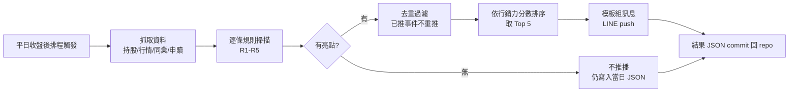

# Spec: 每日行銷亮點引擎（daily-highlight-engine）

> 需求真相（What）。技術實作見 design.md。
> 日期: 2026-07-05 · 範圍: 00991A 單檔 · 輸出: LINE 個人推播

## 1. 產品願景

行銷人員每天收盤後不用自己翻數據，LINE 自動收到一則「今日 00991A 行銷亮點」：每條亮點含**數據事實**＋**建議切入角度**＋**可直接改寫的草稿句**。把 dashboard 生態從「查數據」升級成「送素材上門」。

內容僅供內部發想，**不得出現在對外網站**；對外使用前由人工／法遵流程把關。

## 2. 使用者與場景

- **唯一使用者**：行銷本人（LINE push 至個人 `LINE_TO`，非 broadcast、非群組）。
- 場景 1：每日 18:30 左右收到推播，挑 1–2 條當晚/隔日社群素材。
- 場景 2：週會前翻 repo 內歷史 JSON（或 LINE 對話紀錄）彙整一週亮點。
- 場景 3：某天沒收到推播＝當日無亮點（靜默），不需要任何動作。

## 3. 核心流程



## 4. 功能需求（規則定義＝業務規則）

所有閾值集中於單一設定檔，可調整後重跑（FR-08）。以下為 v1 預設值。

### R1 重倉股表現
- 觸發：00991A **前十大持股**中，任一檔**當日漲幅 ≥ +3%**。
- 加強敘述：若該股在全市場台股主動式 ETF（19 檔）中，00991A 的持有權重為**最高** → 文案升級為「全市場主動 ETF 中持有最重」。
- 不推下跌（行銷用途只取正面事實）。
- 分數 = 當日漲幅% × 持股權重%。

### R2 獨門持股事件
- 定義「獨門股」：00991A 持有、其餘 18 檔台股主動 ETF **皆未持有**；「顯著超配股」：00991A 權重 ≥ 其他持有者最高權重的 **2 倍**且權重 ≥ 1%。
- 觸發：獨門股/顯著超配股**當日漲幅 ≥ +5%** 或 **收盤創 60 個交易日新高**。
- 分數 = 當日漲幅%（創新高視同 +5%）× 持股權重% × 1.5（獨門加乘）。

### R3 操作事後驗證
- 事件母體：回看 **20 個交易日**內的加碼/減碼事件（單日張數變動 ≥ 前日張數的 10%，且權重 ≥ 0.5%）。
- 加碼驗證：自事件日收盤至今報酬 **≥ +8%** → 「經理人 M/D 加碼的 XX 至今 +N%」。
- 減碼躲跌：自事件日收盤至今報酬 **≤ −8%** → 「M/D 減碼 XX，其後回跌 N%」。
- 去重：同一（股票, 事件日）達標**首次推播後不重推**，除非跨過更高門檻（+8% → +15% → +30%，各推一次）。
- 分數 = |至今報酬%| × 2。

### R4 績效里程碑
- 連勝 0050：00991A 日報酬連續勝過 0050 達 **3 / 5 / 10 日**，僅於門檻達成日推。
- 排名事件：MTD 或 YTD 報酬在台股主動 ETF 群**進入前 3 名**（首次進入或名次上升時推）。
- 新高事件：**含息累積報酬**創上市以來新高（距前高 ≥ 5 個交易日才再推，避免連日噪音）。
- 報酬計算口徑**必須與網站「同業績效觀測」分頁一致**（含除息調整）。
- 分數：連勝=天數×3；排名=（4−名次）×10；新高=15。

### R5 資金流事件
- 連續淨申購達 **5 / 10 / 20 個交易日**（門檻日推）。
- AUM 首次突破 **50 億整數倍**關卡。
- 單日淨申購金額為 tw_active 群**第一**且 **> 1 億元**。
- ⚠️ 比較母體＝`peer_redemption` 的 tw_active **觀測群（目前 6 檔）**，非全市場——文案必須寫「觀測同業中」，**不得**宣稱「全市場第一」（行銷素材數字必須可辯護）。
- 分數：連續=天數×2；關卡=12；單日第一=10。

### 通用功能需求
| ID | 需求 |
|----|------|
| FR-01 | 平日收盤後自動執行（目標 18:30 台北，容忍 ±60 分鐘延遲）；可手動觸發重跑 |
| FR-02 | 推播為**單則彙整訊息**：標題（日期＋亮點數）＋依分數排序的亮點段落，**上限 5 條**，超出者僅寫入 JSON |
| FR-03 | 每條亮點含三層：📌 數據事實（模板生成，數字必須可溯源）／💡 切入角度／✍️ 草稿句 |
| FR-04 | 無亮點日**不推播**（靜默），但仍寫當日 JSON（記錄「掃描過、無事件」） |
| FR-05 | 全部候選亮點（含未入選）與當時閾值寫入 `data/highlights/{date}.json` 並 commit 回 repo |
| FR-06 | 去重狀態持久化（repo 內狀態檔），重跑同一日不得重複推播（冪等） |
| FR-07 | 部分資料源故障 → 跳過依賴該源的規則、其餘照常；訊息尾註記「本日未掃描：Rx（來源故障）」。全部故障 → 不推播、workflow 標記失敗（GitHub 失敗通知） |
| FR-08 | 閾值集中單一設定檔；調整後手動重跑即生效，不需改程式 |

## 5. UI/UX（LINE 訊息格式）

純文字單則（無圖片，避開圖床問題）。格式示意：

```
📈 00991A 今日亮點 2026/07/03（3 則）

① 📌 台積電今日 +4.2%，00991A 持股 8.3%、
   為全市場 19 檔主動 ETF 中持有最重
   💡 重倉命中：主動選股的含金量
   ✍️ 「台積電大漲 4.2%，00991A 以 8.3% 持股
   居全市場主動 ETF 之冠，經理人重押命中。」

② 📌 6/20 加碼的 XX 至今 +12.5%
   💡 操作驗證：加碼點位精準
   ✍️ 「…」

③ 📌 連續 7 個交易日淨申購，同業唯一
   💡 資金用腳投票
   ✍️ 「…」

⚠️ 內部參考素材，對外使用前需經法遵檢視
```

- 訊息長度上限 4,500 字元（LINE 上限 5,000，留餘裕），超出時從低分亮點截斷。
- 每則訊息尾固定附「內部參考素材」提醒行。

## 6. 資料需求

| 資料 | 用途 | 既有來源 |
|------|------|----------|
| 00991A 每日持股（張數/權重） | R1/R2/R3 | repo `data/holdings/ETF23.json`（update_holdings 17:30 產出） |
| 全市場台股主動 ETF 持股（**動態清單**，目前約 20 檔，不得寫死） | R1 加強敘述、R2 獨門判定 | active-etf-tracker Supabase（唯讀） |
| 個股日線行情 | R1/R2/R3 漲幅與報酬 | Yahoo Finance（既有用法） |
| 00991A/0050/同業報酬 | R4 | Yahoo Finance（與同業績效分頁同口徑） |
| 同業申贖/AUM | R5 | 自有 Supabase `peer_redemption` |
| LINE 推播 | 輸出 | etf-daily-line 同 channel（`LINE_CHANNEL_TOKEN`/`LINE_TO`） |

## 7. 驗收條件

| AC-ID | 規則 | Given / When / Then | 驗證方式 |
|-------|------|---------------------|----------|
| AC-001 | R1 | Given top10 持股有股當日 +3%，When 掃描，Then 推播含該股名稱、漲幅、權重 | 整合測試（mock 行情） |
| AC-002 | R1 | Given 該股 00991A 權重為 19 檔最高，Then 文案含「持有最重」敘述 | 整合測試 |
| AC-003 | R2 | Given 獨門股當日 +5%，Then 產出獨門亮點；Given 他檔也持有且未達超配倍數，Then 不觸發 | 單元測試 |
| AC-004 | R3 | Given 20 日內加碼事件且至今 +8%，Then 推播；隔日再跑（未跨新門檻），Then 不重推 | 單元測試（狀態檔） |
| AC-005 | R4 | Given 連勝 0050 第 3 日，Then 推播；第 4 日，Then 不推 | 單元測試 |
| AC-006 | R5 | Given 連續淨申購第 5 日，Then 推播含天數 | 單元測試 |
| AC-007 | 通用 | Given 當日無任何規則觸發，Then 不發 LINE、仍寫 JSON | 整合測試 |
| AC-008 | 通用 | Given 7 條候選亮點，Then 訊息僅含分數前 5、JSON 含全部 7 條 | 單元測試 |
| AC-009 | 通用 | Given 同一日重跑，Then 不重複推播（冪等） | 整合測試 |
| AC-010 | 通用 | Given fhtrust 故障，Then R1–R3 跳過、R4/R5 照常、訊息含註記 | 整合測試（mock 故障） |
| AC-011 | 通用 | Given 排程日為非交易日，Then 靜默結束不推播 | 單元測試 |

## 8. 相依與限制

- 上游：fhtrust API 死活（歷史上不穩）、Yahoo 除息延遲雷（沿用網站既有 override 機制口徑）、Supabase 兩個專案的可用性。
- `data/holdings/ETF23.json` 由既有 17:30 update_holdings 排程更新——本引擎排在其後執行（18:30）以取得當日資料。
- 推播內容屬內部素材：**本功能一切產出不得接上任何前端路由**。

## 9. 發布規劃

- **v1**（本 feature）：規則 R1–R5、00991A、LINE 推播、JSON 存檔、閾值設定檔。
- **v2 候選**：R6 受益人數事件（需 TDCC weekly fetcher）、擴 00998A／全產品線、Gemini 潤飾選配、餵入 etf-content-factory、閾值 A/B 調參報告。
